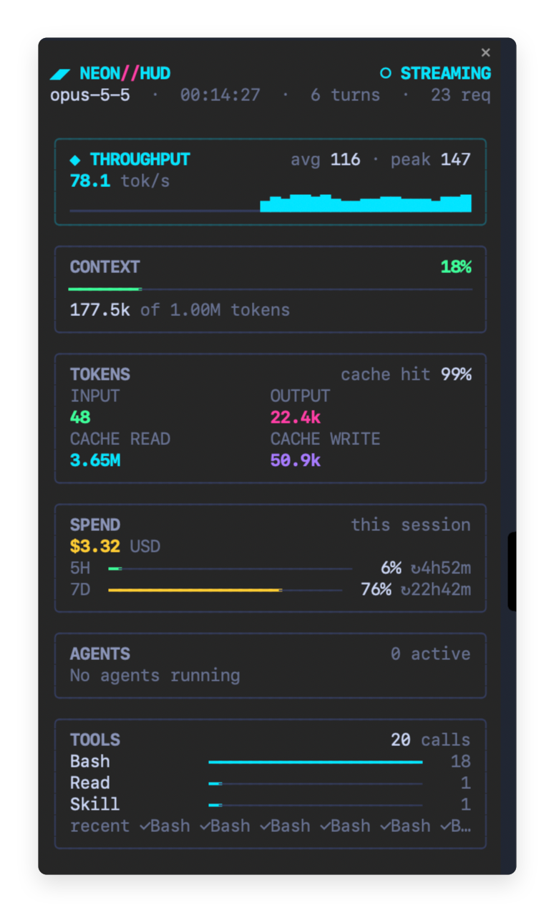
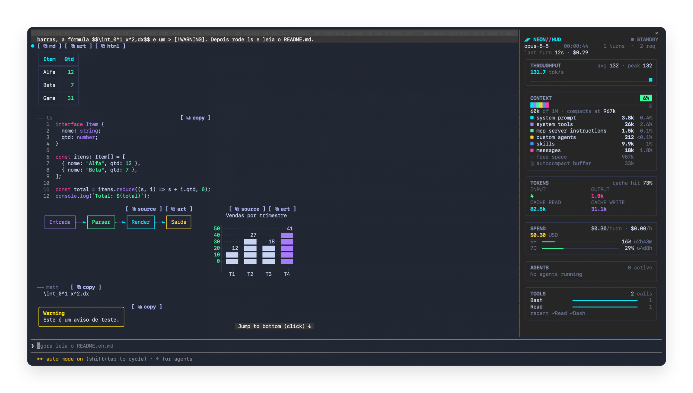

# NEON//HUD

**Português** · [English](README.en.md)

Mod cyberpunk para o [Claude Code](https://claude.com/claude-code) com duas partes:

- **Painel lateral:** mostra ao vivo o que a sessão está fazendo e quanto está custando.
- **Respostas renderizadas:** redesenha as respostas do Claude, as chamadas de ferramenta e o rodapé do turno com a mesma paleta neon do painel. Isso inclui tabelas, código com realce, diagramas mermaid e fórmulas LaTeX.

<p align="center">
  
</p>

## O que ele mostra

| Seção | Conteúdo |
| --- | --- |
| Cabeçalho | Fase atual (`STANDBY`, `SENDING`, `THINKING`, `STREAMING`, `RUNNING`), modelo, tempo de sessão, turnos e requisições; durante o turno, um cronômetro e a ferramenta em execução; depois, a duração e o custo do último turno |
| **Model** | Seletor de modelo e de effort. Os modelos vêm da linha Model do `/config` (os mesmos do `/model`) e a troca é gravada ali, como se fosse feita no menu; o effort (`low` a `max`) é aplicado pelo `/effort`. Escolhido no meio de um turno, vale a partir do próximo. No app mobile o card só mostra os valores atuais. |
| **Throughput** | Tokens por segundo (estimado durante o streaming, exato ao fim de cada requisição), média, pico e histórico das últimas 60 requisições |
| **Context** | A janela de contexto como uma barra empilhada, uma cor por categoria do `/context` (system prompt, ferramentas, MCP, memória, skills, mensagens em rosa), com espaço livre e buffer de autocompact; abaixo, o total, onde a compactação automática roda e uma legenda com tokens e fatia de cada categoria. O selo de % fica verde, amarelo ou vermelho conforme se aproxima do ponto de compactação. Atualiza a cada turno e após `/compact` |
| **Tokens** | Entrada, saída, leitura e escrita de cache, somando a sessão principal e os subagentes, mais a taxa de acerto de cache |
| **Spend** | Custo da sessão em US$ (o mesmo valor do `/cost`), custo médio por turno e por hora, e os limites de 5h e 7d do plano, com o tempo até cada reset |
| **Agents** | Subagentes da sessão, com tipo, status e descrição |
| **Tools** | Total de chamadas, as ferramentas mais usadas e as últimas chamadas agrupadas (`✓Bash×5`; `✓` ok, `✗` erro, `⟳` rodando) |

O cartão que está em atividade acende em ciano: Throughput durante o streaming, Agents com agente rodando, Tools com ferramenta em execução.

## Respostas renderizadas

O neon-hud também redesenha as respostas do Claude, as chamadas de ferramenta e o rodapé do turno com a paleta do painel. O renderizador vem do [prismantis](https://github.com/NahumLitvin/prismantis) (MIT, ver `docs/THIRD_PARTY_NOTICES.md`), com a paleta neon fixa.

<p align="center">
  
</p>

| Recurso | O que muda |
| --- | --- |
| Tabelas | Cabeçalho colorido, réguas, alinhamento `:---:`/`---:`, números coloridos e colunas que encolhem para caber no terminal |
| Código | Cabeçalho com a linguagem e botão de copiar, realce Prism em 24 linguagens, shell colorido como prompt, numeração e dobra de blocos longos |
| Diagramas e gráficos | Blocos `mermaid` (flowchart, sequence, state, class, ER e `xychart-beta`) viram arte colorida; se ficarem largos demais, voltam a ser código |
| LaTeX | `$$…$$` e ` ```math ` como imagem (kitty e Ghostty); texto nos demais casos |
| Layout | Tabelas e diagramas seguidos ficam lado a lado e quebram quando falta largura |
| Botões de cópia | `⧉ md`, `⧉ art` e `⧉ html` nas tabelas, `[ ⧉ copy ]` em código, listas e citações; `/neon-hud copy` e `/neon-hud copy code` copiam sem mouse |
| Linhas de ferramenta | Uma linha por chamada (`Ran gh pr view 12`, `Read ~/src/app.ts`, `Edited README.md`) com ponto de status, grupos resumidos e diffs em cartão |
| Rodapé do turno | `✻ Baked for 6m 20s` com a duração em verde neon; a hora de término é opcional (`clock`) |
| Texto | Negrito, itálico, tachado, código inline, links, versões, durações, percentuais e caminhos com cor própria |

### LaTeX

As fórmulas viram imagem com o [RaTeX](https://github.com/erweixin/RaTeX). Instale o `ratex-render` (troque o arquivo pelo da sua plataforma, como `x86_64-apple-darwin` ou `x86_64-unknown-linux-musl`):

```bash
gh release download -R erweixin/RaTeX -p 'ratex-cli-*-aarch64-apple-darwin.tar.gz'
tar -xzf ratex-cli-*.tar.gz
mkdir -p ~/.local/bin
install ratex-cli-*/render ~/.local/bin/ratex-render
```

Só funciona no kitty e no Ghostty, fora do tmux, e com `latex: true`. Nos outros casos a fórmula aparece como bloco `math`.

### Configuração

Todas as opções ficam em `~/.claude/settings.json` (ou em `/config`); depois, `/reload`:

```json
{
  "pluginConfigs": {
    "neon-hud@neon-hud": {
      "options": { "tableStyle": "grid", "clock": "24h" }
    }
  }
}
```

| Opção | Valores | Padrão | O que faz |
| --- | --- | --- | --- |
| `render` | `true`, `false` | `true` | Liga o redesenho de respostas, ferramentas e rodapé. Desligado, só o painel continua. |
| `tableStyle` | `box`, `rules`, `grid`, `minimal` | `box` | Estilo das tabelas. `box` põe cada célula numa caixa. `rules` traça uma linha entre as linhas da tabela. `grid` usa cabeçalho mais grosso e mais espaço. `minimal` mantém só a linha do cabeçalho. |
| `toolRows` | `true`, `false` | `true` | Uma linha compacta por chamada de ferramenta. |
| `toolStyle` | `chat`, `tree-dim`, `tree-bold`, `classic` | `chat` | Como as linhas de ferramenta ficam ao lado do texto do Claude. `chat` põe as linhas apagadas à direita. `tree-dim` põe as linhas apagadas sob a frase, com `⎿`. `tree-bold` é igual ao `tree-dim`, com as frases de uma linha em negrito. `classic` mantém o visual original. |
| `toolOutput` | `full`, `quiet` | `full` | `quiet` resume cada chamada em palavras simples, mantém os diffs e mostra só a última linha de um erro. Precisa de `toolRows`. |
| `copyButtons` | `true`, `false` | `true` | Botões de copiar em código, tabelas, diagramas, listas e citações. |
| `mermaid` | `true`, `false` | `true` | Desenha blocos `mermaid` como arte. Desligado, o código fica como foi escrito. |
| `mermaidAscii` | `true`, `false` | `false` | Desenha os diagramas com `+ - \| >`, para fontes sem caracteres de caixa. |
| `latex` | `true`, `false` | `false` | Fórmulas como imagem via `ratex-render`. Funciona no kitty e no Ghostty, fora do tmux. |
| `clock` | `off`, `24h`, `12h` | `off` | Mostra a hora em que cada turno terminou. |
| `highlightNumbers` | `true`, `false` | `true` | Colore versões, IDs, contagens e durações. |
| `highlightPaths` | `true`, `false` | `true` | Colore caminhos como `~/src/app.ts`. |
| `pastePreview` | `true`, `false` | `true` | Miniatura de cada imagem colada acima do prompt, antes do envio. |

### Junto com o prismantis

Se o prismantis estiver instalado e ligado, ele desenha as respostas e o neon-hud mostra só o painel. Com o prismantis instalado mas desligado, o neon-hud desenha as respostas normalmente. A verificação se repete quando o mod recarrega. `render: false` desliga o redesenho sem afetar o painel.

## Prévia de imagem colada

Quando você cola uma imagem no prompt, o rascunho mostra só `[Image #1]`. O neon-hud desenha, na faixa acima do prompt, uma miniatura de cada imagem colada, com o tamanho do arquivo, para você conferir se é a imagem certa antes de enviar. Apagar o `[Image #N]` do rascunho tira a miniatura, e enviar o prompt limpa a faixa.

- A miniatura aparece no kitty e no Ghostty, fora do tmux. Nos outros casos aparece só `[Image #N] · 1.4 MB`.
- Com muitas imagens ou pouca largura, ficam só as legendas.
- `pastePreview: false` desliga a prévia. Ela não depende de `render`.
- O neon-hud lê a imagem do arquivo que o Claude Code grava ao colar (`/tmp/claude-<uid>/…/images/N.png`). Esse caminho não faz parte da API de mods: se uma versão nova do Claude Code mudar o caminho, a prévia passa a mostrar `prévia indisponível`.

## Comandos

| Comando | O que faz |
| --- | --- |
| `/hud` | Abre o painel (ou reabre, depois de fechado no `×`). |
| `/neon-hud copy` | Copia a última resposta do Claude, como foi escrita. |
| `/neon-hud copy code` | Copia o último bloco de código da última resposta. |

`/neon-hud` só existe com `render` ligado.

## Requisitos

Uma versão do Claude Code com suporte a mods de *function hooks* (testado na 2.1.293). Essa API ainda é early access e pode mudar entre versões.

## Instalação

Na prompt de uma sessão do Claude Code no terminal, digite:

```
/plugin install neon-hud --marketplace wverri/neon-hud
```

Depois:

1. Responda `y` para adicionar o marketplace `github:wverri/neon-hud`.
2. Escolha o escopo com Enter. O escopo **user** (o primeiro da lista) deixa o painel ativo em todas as suas sessões.
3. Aparece `Installed neon-hud. Plugin is now active.`

Pela linha de comando, fora de uma sessão, o equivalente é:

```bash
claude plugin marketplace add wverri/neon-hud
claude plugin install neon-hud@neon-hud
```

## Ativação

O mod passa a valer **na mesma hora**, sem reiniciar a sessão, e em toda sessão nova a partir daí.

- **Painel automático:** no layout de tela cheia do terminal, com pelo menos 144 colunas, o painel abre sozinho na lateral direita quando a sessão começa.
- **Abrir manualmente:** em qualquer tamanho, digite **`/hud`**. Com o terminal estreito, o painel aparece acima da prompt.
- **Fechar:** clique no `×` do painel. Para reabrir, digite `/hud`.
- **Largura:** o painel pede 46 colunas. Se você arrastar a borda, o seu tamanho é mantido.

O app desktop do Claude Code (aba Code) também carrega o mod quando ele foi instalado pelo terminal no escopo user.

## Atualizar e remover

```bash
claude plugin update neon-hud@neon-hud      # depois, /reload-plugins na sessão
claude plugin uninstall neon-hud@neon-hud
```

## Observações

- Os contadores de tokens, requisições e tok/s ficam salvos por sessão: sobrevivem a reload do mod, a reiniciar o Claude Code e a `--resume`, e zeram no `/clear`. Se você instalar no meio de uma sessão, eles contam a partir dali. Custo, contexto, modelo e turnos sempre mostram o valor real desde o início da sessão.
- Os limites de 5h e 7d só aparecem em planos de assinatura que informam esses limites.
- O mod nunca bloqueia nem altera prompts ou chamadas de ferramenta e não envia nada ao modelo; ele só muda como a sessão aparece na tela.
- Programas externos: `osascript` (macOS) ou `copyq` (Linux) só ao clicar em `⧉ html`, e `ratex-render` com `latex` ligado. Sem rede. A prévia de imagem só lista pastas e lê o tamanho dos arquivos de imagem colados; quem lê a imagem é o terminal.

## Desenvolvimento

```bash
git clone https://github.com/wverri/neon-hud
claude --plugin-dir ./neon-hud      # carrega a cópia local; salvar um arquivo recarrega o mod
claude plugin validate ./neon-hud   # confere o manifesto e o módulo de hooks
claude plugin test ./neon-hud       # roda tests/*.test.tsx
```

Estrutura:

```
.claude-plugin/plugin.json        manifesto do mod e opções (userConfig)
.claude-plugin/marketplace.json   transforma o repositório num marketplace de um plugin
hooks/hooks.json                  aponta para o módulo de hooks
hooks/register.tsx                todos os hooks: sessão, turno, ferramenta, painel e renderizador
hooks/hud.tsx                     desenho e formatação do painel (puro, sem $)
hooks/paste.tsx                   prévia de imagem colada (puro, sem $)
hooks/render/                     renderizador portado do prismantis (puro, sem $)
hooks/render/theme.ts             paleta neon e leitura das opções
hooks/render/vendor/              Prism e beautiful-mermaid empacotados
types/index.d.ts                  contrato do estado ($.state) do mod
tests/hud.test.tsx                testes do painel, incluindo o de largura
tests/neon.test.tsx               testes próprios do renderizador neon
tests/*.test.tsx                  demais testes, portados do prismantis
docs/THIRD_PARTY_NOTICES.md       licenças do prismantis, Prism e beautiful-mermaid
```

O `$` do Claude Code não atravessa `import`, por isso todo código que usa `$` fica em `hooks/register.tsx`.

## Licença

[MIT](LICENSE). O renderizador vem do [prismantis](https://github.com/NahumLitvin/prismantis), também MIT; veja `docs/THIRD_PARTY_NOTICES.md`.
